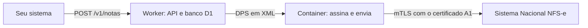

# Emissor de NFS-e Nacional

Emissor de NFS-e que fala direto com a API do Sistema Nacional NFS-e, sem intermediários e sem custo por nota. Ele roda
na sua conta da Cloudflare: o seu sistema envia os dados da venda e recebe a nota autorizada, com o XML, o PDF e links
prontos para mandar ao cliente.

Ele já emite notas em produção para uma ME/EPP do Simples Nacional. Para MEI e empresas fora do Simples, o código segue
o leiaute oficial, mas ainda não foi testado em produção.

## O que ele faz

- Emite a NFS-e e devolve o número, a chave de acesso e o XML autorizado.
- Nunca emite duas notas para a mesma venda: você escolhe o `id`, e repetir o pedido devolve a mesma nota.
- Se a resposta do governo se perder, ele confere se a nota foi emitida antes de enviar de novo.
- Cancela notas.
- Gera o PDF (DANFSe): usa o do governo quando o serviço dele responde; se não, gera um a partir do XML autorizado,
  com QR code para a consulta pública.
- Cria links assinados do PDF e do XML, que podem ir no e-mail do cliente.

Os testes validam os documentos contra os XSDs oficiais e conferem as assinaturas com o `xmlsec1`.

## Quanto custa

| Item | Custo |
|---|---|
| Emissão | Nada: a API do governo é gratuita. |
| Cloudflare | Plano Workers Paid, de US$ 5 por mês, que inclui uma cota de uso de containers. No tipo `lite`, a cota cobre cerca de 100 horas de container ligado por mês, e o container desliga depois de 10 minutos sem uso. Veja os [preços atuais](https://developers.cloudflare.com/containers/pricing/). |
| Certificado digital A1 (e-CNPJ) | Você compra de uma autoridade certificadora e renova todo ano. Se já emite notas, provavelmente já tem um. |

## Como funciona



- O **Worker** (`src/`) recebe as chamadas, guarda as notas num banco D1 e monta os documentos (`src/dps.ts`).
- O **container** (`container/`) assina os documentos (XMLDSig, RSA-SHA256) e fala com o governo usando o
  certificado. Ele existe porque os servidores do governo só pedem o certificado do cliente depois que a conexão já
  está aberta (renegociação TLS), e o `fetch` dos Workers não faz isso.
- O número da DPS vem de um contador no D1 e nunca se repete. Se um número já tiver sido usado fora daqui (no portal do
  governo, por exemplo), o emissor passa para o próximo.

## Antes de começar

Você vai precisar de:

1. **Município ativo no Sistema Nacional NFS-e.** Depois da instalação, o `/health?deep=1` confirma isso com uma
   consulta real ao governo.
2. **Certificado A1 (e-CNPJ) do prestador**: o arquivo `.pfx` e a senha.
3. **Dados do seu contador**: a situação no Simples Nacional, a alíquota aproximada do Simples (para ME/EPP), o código
   de tributação nacional do serviço e, se ele pedir, o código NBS.
4. **Conta na Cloudflare** no plano Workers Paid.
5. **Node.js 22.12 ou mais recente**, o **pnpm** (rode `corepack enable`) e o **Docker** aberto, porque o deploy monta a
   imagem do container na sua máquina.

## Instalação

```sh
git clone https://github.com/gabrielbuzziv/emissor-nfse-nacional.git
cd emissor-nfse-nacional
pnpm install
pnpm wrangler login
```

### 1. Configure os dados do emissor

Preencha os `vars` do `wrangler.jsonc`:

| Variável | O que é |
|---|---|
| `NFSE_ENVIRONMENT` | `restricted` (produção restrita, o ambiente de testes do governo) ou `production` (notas de verdade). Comece com `restricted`. |
| `ISSUER_CNPJ` | O CNPJ do prestador. |
| `ISSUER_CITY_CODE` | O código IBGE do município do CNPJ, com 7 dígitos ([consulte no IBGE](https://www.ibge.gov.br/explica/codigos-dos-municipios.php)). |
| `ISSUER_MUNICIPAL_SUBSCRIPTION` | A inscrição municipal. Deixe vazio, a menos que o município tenha cadastrado a empresa no Cadastro Nacional de Contribuintes (CNC); sem esse cadastro, a nota é recusada com o erro E0120. |
| `ISSUER_SIMPLES_OPTION` | A situação no Simples Nacional: `1` = não optante; `2` = MEI; `3` = ME/EPP. |
| `ISSUER_SIMPLES_APURATION` | Só para ME/EPP. `1` = tributos federais e municipal apurados pelo Simples Nacional, o caso mais comum. As outras opções estão no `wrangler.jsonc`. |
| `ISSUER_SIMPLES_TOTAL_TAX_PERCENT` | Só para ME/EPP. A alíquota aproximada dos tributos do Simples (Lei 12.741/2012), com ponto e 2 casas decimais, por exemplo `6.00`. |
| `DPS_SERIES` | A série das DPS, com até 5 dígitos. O padrão é `1`. |

Por padrão, a API fica em `https://emissor-nfse.<seu-subdominio>.workers.dev`. Para usar um domínio próprio, siga o
comentário de `routes` no `wrangler.jsonc`.

### 2. Faça o deploy e crie as tabelas

```sh
pnpm run deploy
pnpm run migrate
```

O primeiro deploy cria o banco D1 `emissor-nfse`, e o `migrate` cria as tabelas.

### 3. Envie o certificado e crie o token

```sh
pnpm run certificate caminho/do/certificado.pfx
```

O script pede a senha e confere se o certificado abre, se está na validade e se é do CNPJ configurado. Depois, envia
tudo como secrets do Worker. Ele também aceita os arquivos `.pfx` mais antigos (RC2/3DES), comuns em certificados A1.

Gere um token para os seus sistemas chamarem a API e salve-o como secret (cole o token quando o Wrangler pedir):

```sh
node -e "console.log(require('node:crypto').randomBytes(32).toString('hex'))"
pnpm wrangler secret put API_TOKEN
```

Guarde o token num lugar seguro: ele protege a API e também assina os links públicos das notas. Trocar o token
invalida os links já enviados.

### 4. Confira a instalação

```sh
curl -H "Authorization: Bearer $API_TOKEN" "https://emissor-nfse.<seu-subdominio>.workers.dev/health?deep=1"
```

Com tudo certo, a resposta traz `"ok": true`, a validade do certificado em `container.certNotAfter` e o convênio do
município em `cityAgreement`. Se faltar alguma variável, ela aparece em `config`.

### 5. Teste e vá para a produção

Com `NFSE_ENVIRONMENT` em `restricted`, as notas vão para a produção restrita e não têm valor fiscal. Troque o
`serviceCode` pelo código do seu serviço:

```sh
curl -X POST "https://emissor-nfse.<seu-subdominio>.workers.dev/v1/notas" \
  -H "Authorization: Bearer $API_TOKEN" \
  -H "content-type: application/json" \
  -d '{"id":"teste-1","serviceCode":"080201","description":"Nota de teste","valueCents":100}'
```

A produção restrita não tem todos os municípios. Se o seu não estiver lá (o `/health?deep=1` mostra), não dá para
testar a emissão antes da produção.

Para emitir notas de verdade:

1. Apague as notas de teste e zere a numeração. Os testes ficam no mesmo banco, e um `id` usado no teste devolveria a
   nota de teste. Faça isso só agora, nunca depois de ir para a produção:
   ```sh
   pnpm wrangler d1 execute emissor-nfse --remote --command "DELETE FROM notas; DELETE FROM counters;"
   ```
2. Mude `NFSE_ENVIRONMENT` para `production` e rode `pnpm run deploy`.
3. Rode o `/health?deep=1` de novo.
4. Emita a primeira nota de uma venda real e confira os dados na consulta pública (o link `links.lookup` da resposta)
   antes de ligar a emissão automática.

## API

Todas as rotas pedem o cabeçalho `Authorization: Bearer <API_TOKEN>`, menos os links públicos das notas.

| Rota | O que faz |
|---|---|
| `POST /v1/notas` | Emite uma nota. Repetir o pedido com o mesmo `id` devolve a mesma nota. |
| `GET /v1/notas/:id` | Mostra a nota; com `?xml=1`, inclui o XML da NFS-e. |
| `GET /v1/notas/:id/pdf` | Devolve o PDF da nota (DANFSe). |
| `POST /v1/notas/:id/cancel` | Cancela a nota. |
| `GET /v1/notas` | Lista as notas, das mais recentes para as mais antigas. |
| `GET /health` | Confere a configuração, o container e a validade do certificado; com `?deep=1`, também consulta o município no governo. |

### Emitir

```json
POST /v1/notas
{
  "id": "pedido-1001",
  "competence": "2026-11-10",
  "taker": { "taxId": "123.456.789-09", "name": "Maria Silva", "email": "maria@example.com" },
  "serviceCode": "080201",
  "nbsCode": "122051900",
  "description": "Curso online de fotografia",
  "valueCents": 9700
}
```

| Campo | O que é |
|---|---|
| `id` | Obrigatório. O identificador da venda no seu sistema, com até 200 caracteres. É ele que impede notas duplicadas. |
| `competence` | A data da prestação do serviço (`AAAA-MM-DD`), que não pode ser posterior à emissão. Se ficar de fora, vale a data de hoje em Brasília. |
| `taker` | O tomador: `taxId` (CPF ou CNPJ, com ou sem pontuação), `name` e, se quiser, `email`. Sem ele, a nota sai sem tomador identificado. |
| `serviceCode` | Obrigatório. O código de tributação nacional, com 6 dígitos (`080201` é o item 08.02.01). |
| `nbsCode` | O código NBS, com 9 dígitos. |
| `description` | Obrigatório. A descrição do serviço, com até 2.000 caracteres. |
| `valueCents` | Obrigatório. O valor do serviço em centavos (`9700` é R$ 97,00). |

A resposta é a nota, e o código HTTP diz o que aconteceu:

- **200**: emitida (`status: "issued"`). A nota traz `nfseNumber`, `accessKey` e `links`: o `pdf` e o `xml`, que são
  links públicos assinados, e o `lookup`, a consulta pública do governo.
- **422**: recusada (`status: "rejected"`), com os erros do governo em `errors`. Corrija o pedido e envie de novo com o
  mesmo `id`; o número da DPS é reaproveitado.
- **202**: o governo não respondeu (`status: "unknown"` ou `"pending"`). Envie o mesmo pedido mais tarde: antes de
  reenviar, o emissor confere se o governo chegou a emitir a nota.
- **400**: pedido inválido; o campo `error` diz o que corrigir.

### Cancelar

```json
POST /v1/notas/pedido-1001/cancel
{ "reasonCode": "2", "reason": "Venda cancelada e valor devolvido ao cliente" }
```

O `reasonCode` pode ser `1` (erro na emissão), `2` (serviço não prestado, o padrão) ou `9` (outros). O `reason` é
opcional; o governo exige de 15 a 255 caracteres, e textos menores são completados com pontos.

- **200**: cancelada.
- **422**: o governo recusou, e o motivo está em `cancelErrors`. O prazo para cancelar depende do município; depois
  dele, a nota precisa ser substituída, e este emissor ainda não faz substituição.
- **409**: a nota não está emitida. **404**: a nota não existe. **502**: o governo não respondeu; tente de novo.

### Listar

`GET /v1/notas?status=issued&limit=50`: o `status` filtra (`pending`, `unknown`, `issued`, `rejected` ou `canceled`), e
o `limit` vai até 100 (o padrão é 50). Para a página seguinte, passe em `before` o `createdAt` da última nota da página.

### Fluxo recomendado

1. Quando o pagamento for confirmado, chame `POST /v1/notas` com o identificador da venda.
2. **200**: guarde a nota e mande os `links` ao cliente.
3. **202**: tente de novo mais tarde, com o mesmo pedido. Um cron a cada poucos minutos resolve.
4. **422**: veja `errors`, corrija e envie de novo com o mesmo `id`.
5. Se a venda for estornada, chame `POST /v1/notas/:id/cancel`.

## Renovar o certificado

Antes do vencimento, rode `pnpm run certificate novo-certificado.pfx`. As chamadas seguintes já usam o certificado
novo, sem deploy; confira a validade em `GET /health` (`container.certNotAfter`).

## Problemas comuns

| Sintoma | O que fazer |
|---|---|
| O `/health` mostra `config` | Corrija as variáveis listadas no `wrangler.jsonc` e rode `pnpm run deploy`. |
| `container.error` diz `no certificate` | Envie o certificado com `pnpm run certificate`. |
| `container.error` diz `cannot open the certificate` | A senha enviada não abre o certificado; rode `pnpm run certificate` de novo. |
| `cityAgreement` sem status 200 | O município não está ativo nesse ambiente (a produção restrita não tem todos), ou o governo recusou o certificado. |
| Nota recusada com `HTTP 403` | O governo recusou o certificado: confira se ele é um e-CNPJ ICP-Brasil do prestador e se está na validade. |
| Nota recusada com `E0120` | Deixe `ISSUER_MUNICIPAL_SUBSCRIPTION` vazio. |
| Nota parada em `unknown` | O governo não respondeu. Envie o mesmo pedido mais tarde; se continuar assim, veja o `/health`. |

## Limitações

Este emissor cobre o caso mais comum de prestação de serviços:

- serviço prestado no município do prestador, com ISSQN devido e não retido;
- sem regime especial de tributação, deduções, descontos ou tributos federais destacados na nota;
- tomador com CPF ou CNPJ, sem endereço, ou nota sem tomador;
- uma série de DPS e nenhuma substituição de nota.

O governo muda o leiaute por meio de notas técnicas e costuma liberar as mudanças antes na produção restrita, que hoje
já usa o leiaute da NT 009. Quando a produção mudar, o `src/dps.ts` precisa acompanhar.

## Desenvolvimento

```sh
pnpm test            # documentos contra os XSDs oficiais, assinaturas e fluxos de emissão e cancelamento
pnpm run typecheck
pnpm run dev         # roda tudo na sua máquina, com o container no Docker
```

Os testes usam o `xmllint` e o `xmlsec1`. No macOS, rode `brew install libxmlsec1` (o `xmllint` já vem no sistema); no
Debian ou no Ubuntu, `sudo apt install libxml2-utils xmlsec1`.

Para o `pnpm run dev`, crie um `.dev.vars` a partir do `.dev.vars.example`, com o `.pfx` em base64 em `CERT_PFX_B64_1`.

Contribuições são bem-vindas: abra uma issue ou um pull request, com `pnpm test` e `pnpm run typecheck` passando.

## Segurança

- Use o token da API só no servidor, nunca no navegador ou em apps.
- O certificado e a senha ficam guardados como secrets na Cloudflare. O `.gitignore` bloqueia arquivos `.pfx`, `.p12`,
  `.pem` e `.key`; nunca coloque esses arquivos no repositório.
- Os links públicos das notas são assinados com uma chave derivada do token.

## Aviso

Este projeto não tem vínculo com a Receita Federal nem com o Sistema Nacional NFS-e e é distribuído sem garantia (veja a
[licença](LICENSE)). A responsabilidade pelas notas é de quem as emite: confirme a configuração fiscal com o seu
contador.

## Referências

- [Portal da NFS-e](https://www.gov.br/nfse)
- [Documentação técnica](https://www.gov.br/nfse/pt-br/biblioteca/documentacao-tecnica)
- [Manual das APIs para contribuintes (PDF)](https://www.gov.br/nfse/pt-br/biblioteca/documentacao-tecnica/documentacao-atual/manual-contribuintes-apis-adn-sistema-nacional-nfse.pdf)
- [Produção restrita](https://www.gov.br/nfse/pt-br/biblioteca/documentacao-tecnica/producao-restrita)
- [Preços dos containers da Cloudflare](https://developers.cloudflare.com/containers/pricing/)

## Licença

[MIT](LICENSE)
